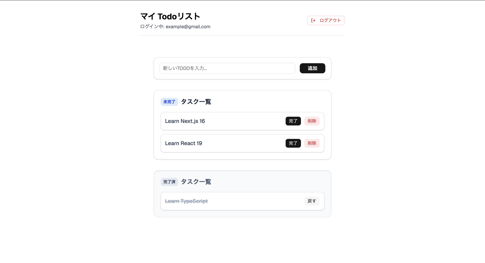

# フルスタック Todo Application

**🌐 Live Demo:** [https://todo-app-nine-virid-67.vercel.app/](https://todo-app-nine-virid-67.vercel.app/)



モダンなWebフロントエンド技術とサーバーレスアーキテクチャを活用して構築された、フルスタックのタスク管理（Todo）アプリケーションです。今回、Supabase Authを利用したセキュアなユーザー認証機能を追加し、マルチユーザーでのタスク管理に対応しました。

## 🛠 技術スタック

- **フロントエンド:** Next.js (App Router), React, TypeScript
- **スタイリング:** Tailwind CSS, shadcn/ui (カスタマイズ)
- **バックエンド:** Next.js Server Actions
- **データベース・認証:** Supabase (PostgreSQL / Supabase Auth)
- **O/Rマッパー:** Prisma
- **インフラ・デプロイ:** Vercel (Hobbyプラン)
- **コード品質:** ESLint, Prettier, TypeScript (厳格な型定義)

## 💡 機能要件

ユーザーが直感的にタスクを管理できるよう、無駄を省いたシンプルな1画面（SPAライク）構成としています。

- **ユーザー認証・保護機能 (Auth)** *(New!)*
  - `@supabase/auth-ui-react` を利用した、メールアドレス・パスワードによるサインアップおよびログイン機能。
  - 未認証ユーザーのトップページアクセスをブロックし、ログイン画面へ強制リダイレクトするルート保護。
  - セッション情報に基づくタスクの分離（ログインユーザー本人が作成したTodoのみを表示・操作）。
- **タスクの追加 (Create)**
  - 任意のテキストを入力し、新しいタスクを作成。
  - 未完了タスクが5個以上ある場合は入力フォームを非活性（disabled）にし、警告メッセージを表示。
- **タスクの一覧表示 (Read)**
  - データベースから取得したタスクを「未完了」と「完了済」の2つのリストに分類して表示。
- **タスクのステータス更新 (Update)**
  - 未完了タスクの「完了」ボタン押下で、対象タスクを完了済リストへ移動。
  - 完了済タスクの「戻す」ボタン押下で、対象タスクを未完了リストへ戻す。
- **タスクの削除 (Delete)**
  - 未完了タスクの「削除」ボタン押下で、データベースから物理削除。

## 🧩 コンポーネント構成

設計の責務を分離するため、UIパーツとロジックを分割してコンポーネント化しています。

| コンポーネント名 | 役割・責務 |
| :--- | :--- |
| **`Todo`** | ページ全体のレイアウト管理。Server Actionsの呼び出しと、各子コンポーネントへのデータ（Props）伝播を担う。 |
| **`InputTodo`** | タスクの入力フォームと追加ボタン。上限（5個）到達時の非活性制御を行う。 |
| **`IncompleteTodos`** | 未完了タスクのリスト表示。「完了」「削除」のアクションをハンドリングする。 |
| **`CompleteTodos`** | 完了済タスクのリスト表示。「戻す」のアクションをハンドリングする。 |
| **`TodoItem`** | 各タスクの行アイテム（見た目）を定義する汎用UIコンポーネント。 |
| **`LoginPage`** | Supabase公式UIを活用したログイン・新規登録フォームコンポーネント。 |
| **`LogoutButton`** | shadcn/uiのButtonとLucideアイコンで構成された、セッション破棄・ログアウト実行コンポーネント。 |

## 🗄 データベース設計 (スキーマ)

Prismaを利用して構築された単一の `Todo` テーブルです。拡張性を考慮し、IDには衝突リスクのないUUIDを採用しています。

| カラム名 (物理名) | データ型 | 制約・デフォルト値 | 説明 |
| :--- | :--- | :--- | :--- |
| **id** | String (UUID) | Primary Key, `uuid()` | タスクを一意に識別するID |
| **userId** | String | Not Null | タスクを作成・所有するユーザーのID（Supabase AuthのUUID） |
| **text** | String | Not Null | タスクの内容（入力テキスト） |
| **isCompleted** | Boolean | Default: `false` | タスクの完了状態フラグ |
| **createdAt** | DateTime | Default: `now()` | レコード作成日時 |

## 🚀 デプロイと運用要件

安定した稼働と、無料枠（Free Tier）での継続的な運用を実現するためのインフラ構成です。

- **CI/CDパイプライン:** GitHubの `main` ブランチへのPushを検知し、Vercelが自動的にビルドとデプロイ（`prisma generate` を含む）を実行します。
- **コネクションプーリング:** Next.jsの開発環境（ホットリロード）によるデータベースの接続過多を防ぐため、`lib/prisma.ts` にてグローバルにPrismaClientをキャッシュし、接続を安全に再利用する設計を採用しています。
- **コールドスリープ対策:** Supabaseの無料プランにおける7日間の無アクセス停止（スリープ）を防止するため、Vercel CronとNext.js API Routesを連携し、毎日午前0時に死活監視（自動アクセス）を実行する仕組みを導入しています。

## 💻 ローカル環境での起動方法

```bash
# 1. リポジトリのクローン
git clone https://github.com/yk242/todo-app.git

# 2. パッケージのインストール
npm install

# 3. 環境変数の設定
# .env ファイルを作成し、データベースおよびSupabaseの接続情報を設定してください
# DIRECT_URL=="postgresql://..."
# DATABASE_URL="postgresql://..."
# APP_ENV="local"
# NEXT_PUBLIC_SUPABASE_URL="http://127.0.0.1:54321"
# NEXT_PUBLIC_SUPABASE_ANON_KEY="eyJhbGciOi..."

# 4. データベースの同期とPrisma Clientの生成
npx prisma db push
npx prisma generate

# 5. 開発サーバーの起動
npm run dev
```
